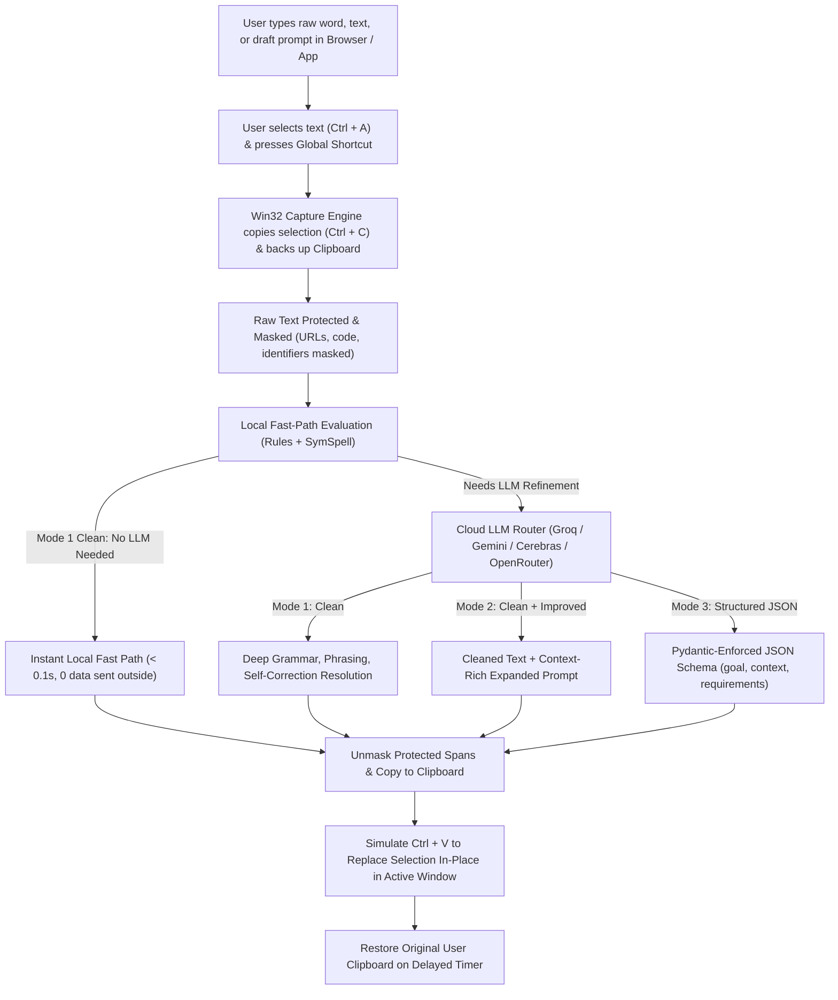

# Product Requirements Document (PRD)

## Project: TextPrompt AI (Cloud Free-Tier Edition)
**Document Version:** 1.1.0  
**Status:** Approved / Active  
**Author:** Pair Programming Session  
**Target Platform:** Windows 10/11 (Cross-platform extensible architecture)

---

## 1. Executive Summary & Objective

Typing quickly into a browser, AI chat box, IDE, or messaging app often produces raw, unpolished text—plagued by typos, shorthand abbreviations, broken grammar, stream-of-consciousness rambling, inline self-corrections (*"use sqlite wait no postgres"*), unformatted technical terms (*"app dot py"*, *"fastapi"*), or under-specified prompts.

**TextPrompt AI (Cloud Free-Tier Edition)** is an ultra-lightweight, system-wide desktop companion tool that transforms raw typed text in-place. Given a word, sentence, or draft prompt typed into a browser or any application, the user selects the text (`Ctrl + A` or highlight) and triggers a global shortcut. The tool captures the selected text, processes it using a hybrid architecture—a local deterministic rule/typo engine combined with **free-tier cloud LLM APIs** (Groq, Google AI Studio / Gemini Flash-Lite, OpenRouter `:free`, and Cerebras)—and automatically replaces the selected text in-place (`Ctrl + V`) inside the active window (Gemini Web, ChatGPT, Claude, Antigravity IDE, Slack, Email, etc.).

### Key Architectural Tenets
1. **$0 Operating Cost**: 100% powered by cloud free tiers (no credit card, no billing enabled).
2. **Zero GPU / Minimal System Footprint**: No local model weights, no Ollama daemon, and no GPU requirements. The app stays at **< 1% CPU idle** and **< 150 MB RAM**.
3. **Speed First**: Sub-second round trips via persistent HTTP/2 connection pools, latency-ranked multi-provider routing, and an instant local fast-path for simple text.
4. **Data Transmission Disclosure**: External cloud inference means selected text is transmitted over HTTPS to third-party cloud providers (see Section 6 for full privacy details and safeguards).

---

## 2. Core User Flow



### Detailed Interaction Steps
1. **Type**: The user types a rough word, sentence, or prompt into any browser text field or desktop app (e.g., *"um fix bug in app.py where sqlite connection times out wait actually use postgres and add retry"*).
2. **Select**: The user selects the text using `Ctrl + A` (or highlights a specific portion of text). *(Optional config: `auto_select_all: true` automatically sends `Ctrl + A` prior to copy).*
3. **Trigger**: The user presses the Global Shortcut:
   - `Ctrl + Alt + Space`: Execute currently active mode.
   - `Ctrl + Alt + 1 / 2 / 3`: One-shot execution of Mode 1, Mode 2, or Mode 3 directly.
   - `Ctrl + Alt + M`: Cycle active mode.
4. **Capture & Mask**: The app backs up the user's clipboard, detects the selection via `Ctrl + C`, and masks sensitive tokens (code blocks, URLs, emails, identifiers).
5. **Clean & Improve**:
   - Simple Mode 1 corrections take the **instant local fast-path** (no network egress).
   - Complex corrections and Modes 2/3 route to the fastest healthy **free-tier cloud provider**.
6. **In-Place Replace**: Keystroke `Ctrl + V` replaces the highlighted text in the active window atomically; the user's prior clipboard is restored after a short delay.

---

## 3. The 3 Output Modes

### Mode 1: Clean (`clean_only`)
* **Purpose**: Direct text cleanup for fast typing, emails, chat messages, code comments, or quick instructions without expanding the scope.
* **Transformations**:
  - Fix spelling mistakes and typos via local SymSpell or fast cloud model.
  - Strip conversational filler words and typing shorthand (*"um"*, *"uh"*, *"pls"* $\to$ *"please"*, *"thx"* $\to$ *"thanks"*, *"w/"* $\to$ *"with"*).
  - Resolve inline self-corrections and false starts (*"use sqlite, wait actually postgres"* $\to$ *"Use PostgreSQL."*).
  - Format spoken or shorthand coding syntax (*"app dot py"* $\to$ `app.py`, *"camel case user id"* $\to$ `userId`, *"git checkout dash b"* $\to$ `git checkout -b`).
  - Apply standard capitalization and technical casing from `vocabulary.txt` (`fastapi` $\to$ `FastAPI`, `nextjs` $\to$ `Next.js`).

### Mode 2: Clean + Improved (`clean_plus_improved`)
* **Purpose**: Turns a single keyword, rough phrase, or terse draft prompt into a comprehensive, high-clarity prompt for reasoning LLMs, creative writing, or complex engineering tasks.
* **Transformations**:
  - Performs all Mode 1 cleaning first.
  - Generates an enhanced version of the prompt that adds necessary clarity, context requirements, expected tone, and edge-case reminders in concise bullet points.
* **Output Format**:
  ```markdown
  Review `app.py` and implement error handling for the SQLite database connection.

  ---
  **Enhanced Prompt:**
  Please review `app.py` and add resilient error handling around the SQLite database connection. Specifically:
  - Handle `sqlite3.OperationalError` and connection timeout scenarios.
  - Implement automatic retry with exponential backoff if the database is locked.
  - Ensure all database cursors and connections are safely closed in a `finally` block or context manager.
  ```

### Mode 3: Structured JSON Prompt (`structured_json`)
* **Purpose**: Optimized for LLMs, agentic workflows, and function-calling orchestrators (Gemini, Claude, Antigravity). Converts raw typed instructions into a strict, validated JSON schema.
* **Output Format**:
  ```json
  {
    "goal": "Implement error handling for SQLite connection in app.py",
    "context": {
      "target_file": "app.py",
      "database": "SQLite"
    },
    "requirements": [
      "Handle connection timeouts and operational errors",
      "Ensure proper connection cleanup"
    ],
    "constraints": {
      "language": "Python",
      "style": "idiomatic, use context managers"
    },
    "expected_output": "Updated app.py with robust error handling"
  }
  ```

---

## 4. System Architecture & Components

```mermaid
graph LR
    subgraph Client / OS Level
        HK["Native Win32 Hotkeys\n(RegisterHotKey)"]
        CAP["Selection Capture\n(Ctrl+C + Clipboard Polling)"]
        MASK["Protected-Span Masking\n(URLs, Code, Paths)"]
        PASTE["In-Place Replace\n(SendInput Ctrl+V)"]
        TRAY["System Tray & Status Pill\n(pystray + tkinter)"]
    end

    subgraph Local Deterministic Layer (< 10 ms)
        RULES["Rule Engine\n(Shorthand, Fillers, Tech Terms)"]
        SPELL["Typo Engine\n(symspellpy Frequency Dict)"]
    end

    subgraph Cloud Free-Tier Router
        ROUTER["Multi-Provider Router\n(HTTP/2 Pool, Latency Ranking, Hedging)"]
        GROQ["Groq Cloud API\n(Llama 3.1 8B / 3.3 70B)"]
        GEMINI["Google AI Studio\n(Gemini 2.5 Flash-Lite)"]
        CEREBRAS["Cerebras Cloud API\n(Llama 3.1 8B)"]
        OPENROUTER["OpenRouter Free API\n(:free Models)"]
        OFFLINE["RuleBackend\n(Offline / Quota Fallback)"]
    end

    HK --> CAP
    CAP --> MASK
    MASK --> RULES
    RULES --> SPELL
    SPELL -.->|Fast Path Hit| PASTE
    SPELL -->|Needs LLM| ROUTER
    ROUTER --> GROQ
    ROUTER --> GEMINI
    ROUTER --> CEREBRAS
    ROUTER --> OPENROUTER
    ROUTER -.->|Failover| OFFLINE
    GROQ --> PASTE
    GEMINI --> PASTE
    CEREBRAS --> PASTE
    OPENROUTER --> PASTE
    OFFLINE --> PASTE
    TRAY -.->|Mode / Quota| ROUTER
```

### Detailed Component Specifications

1. **Global Hotkey Hook (`hotkeys.py` & `keys.py`)**:
   - Native Win32 `RegisterHotKey` message loop (0% idle CPU, no raw keyboard hooks).
   - Injects modifier key-ups (`Ctrl`, `Alt`, `Shift`) before simulating copy/paste to avoid keystroke collisions.
   - Pre-warms the target provider's HTTP/2 connection immediately upon hotkey down.

2. **Text Capture & In-Place Replacement (`text_capture.py` & `injector.py`)**:
   - Full clipboard format backup (text, HTML, images) before capture.
   - Event-driven copy confirmation via `GetClipboardSequenceNumber` (detects copy in 10–40 ms).
   - Per-app copy/paste rules (e.g., `WindowsTerminal.exe` uses `Ctrl + Shift + C/V`).
   - Verifies active window `HWND` before pasting to prevent pasting into an unintended application if focus changes.
   - Asynchronous clipboard restoration after a configurable delay (default: `400ms`).

3. **Protected-Span Masking (`core/masking.py`)**:
   - Automatically detects and replaces sensitive/structured tokens (URLs, emails, file paths, code blocks, `camelCase`/`snake_case` variables, CLI flags) with placeholders (e.g. `⟦0⟧`, `⟦1⟧`) prior to processing.
   - Protects sensitive tokens from external modification and prevents third-party model hallucinations on technical identifiers.

4. **Deterministic Cleaning Layer (`core/rules/` & `core/typo.py`)**:
   - **Shorthand & Fillers**: Expands typing shorthand (`shorthand.txt`) and strips filler words.
   - **Spoken Syntax & Tech Capitalization**: Formats spoken syntax and enforces case accuracy against `vocabulary.txt` (~200+ terms like `FastAPI`, `PostgreSQL`).
   - **Typo Correction (`symspellpy`)**: Corrects misspellings in < 2ms using a frequency dictionary; skips vocabulary words and non-English text.
   - **Mode 1 Fast Path**: If text has no self-corrections, grammar risks, or unresolved typos, it is immediately pasted without any cloud API call.

5. **Cloud LLM Multi-Provider Router (`core/llm/`)**:
   - Single unified `OpenAICompatibleBackend` client operating over persistent HTTP/2 pools.
   - **Provider Roster (Free Tier Only)**:
     - **Groq**: Primary provider for ultra-fast Mode 1/2 inference (`llama-3.1-8b-instant`, `llama-3.3-70b-versatile`).
     - **Google AI Studio (Gemini)**: Primary for Mode 3 JSON schema enforcement (`gemini-2.5-flash-lite`).
     - **Cerebras**: High-speed fallback for 8B models.
     - **OpenRouter (`:free`)**: Broad fallback for free community models.
   - **Intelligent Routing**: Tracks live token-bucket limits, re-ranks providers by real latency exponential moving average (EMA), supports delayed hedging, and falls back to local `RuleBackend` if offline or quotas are exhausted.
   - **Safety Guards**: Enforces `<input_text>` wrapper tags, anti-answering instructions, token overlap checks, and Pydantic JSON validation.

6. **Desktop Tray & Visual Feedback (`tray_app.py` & `overlay.py`)**:
   - `pystray` system tray icon with real-time status and daily free quota usage counters.
   - Non-activating, click-through status pill (`WS_EX_NOACTIVATE | WS_EX_TRANSPARENT`) displaying progress without stealing focus from the active browser/editor.
   - Subtle audio cues via `winsound.PlaySound(..., SND_ASYNC)`.

---

## 5. Non-Functional Requirements & Performance Targets

- **Latency Budget (Shortcut Trigger $\to$ In-Place Replacement)**:
  - **Local Fast Path (Mode 1)**: **≈ 0.05s – 0.10s** (p95 < 0.15s).
  - **Cloud Mode 1 (Groq / Cerebras)**: **≈ 0.30s – 0.60s** (p95 < 1.0s).
  - **Cloud Modes 2 & 3 (Groq / Gemini)**: **≈ 0.50s – 1.40s** (p95 < 1.5s).
- **Resource Footprint**:
  - Idle CPU usage: **< 1%**.
  - RAM footprint: **< 150 MB**.
  - Zero GPU / VRAM requirements; executable on standard laptops and office workstations.
- **Cost**:
  - **$0 forever**. Operates exclusively on free-tier allocations without billing accounts.
- **Reliability & Focus Integrity**:
  - Absolute focus preservation: `WS_EX_NOACTIVATE` guarantees the active text selection is never un-highlighted before `Ctrl + V` executes.
  - Fail-safe clipboard preservation: original clipboard contents are restored even if the application errors or the user switches windows.

---

## 6. Privacy, Security & Data Handling Disclosures

> [!WARNING]
> **Cloud Tier Privacy Trade-Off**: Because this edition relies on external cloud free tiers rather than heavy local models, **selected text that requires LLM processing is transmitted over the internet to external cloud providers**.

### Data Flow & Transmission Specifics
1. **Outbound Data**:
   - When an LLM call is triggered, the masked text (with sensitive spans replaced by placeholders) is transmitted via HTTPS POST requests to the active provider (Groq, Google AI Studio, Cerebras, or OpenRouter).
2. **Third-Party Data Policies**:
   - Free-tier terms vary by provider. In particular, free-tier prompts submitted to **Google AI Studio (without billing enabled)** or certain **OpenRouter free models** may be logged or utilized for model training and service improvement by the respective vendors.
3. **Local Fast Path Exemption**:
   - On simple text modifications (Mode 1 without complex self-corrections or grammar restructuring), the **Fast Path executes 100% locally**. In these instances, **0 bytes leave the machine**.
4. **Privacy Safeguards & Controls**:
   - **Protected-Span Masking**: URLs, auth tokens, file system paths, emails, and code variables are masked before leaving the device and re-inserted locally after generation.
   - **Strict No-Logging Policy**: By default, the application never logs or persists user text to disk (`debug_log_text: false`).
   - **Credential Security**: API keys are securely stored in the native Windows Credential Manager (`keyring`) and are never written to `config.yaml` or printed in logs.
   - **Exclude Training Providers**: Users can configure `exclude_training_providers: true` to prevent requests from routing to providers that log or train on free-tier data.

---

## 7. Phased Implementation Milestones

- **Phase 0 — Environment, Free API Keys & Provider Benchmark**:
  - Project scaffold with `uv` (Python 3.11) and SymSpell frequency dictionary.
  - Interactive key setup wizard saving free keys to Windows Credential Manager.
  - Benchmark script measuring real latency and JSON support across Groq, Gemini, OpenRouter, and Cerebras.
- **Phase 1 — Core Selection Capture & In-Place Replace (PoC)**:
  - Native Win32 `RegisterHotKey` listener with clean modifier release.
  - Selection capture via `Ctrl + C` and sequence-number polling.
  - In-place replacement via `Ctrl + V` with active-window verification and full clipboard restore.
- **Phase 2 — Deterministic Cleaning Layer (Masking, Rules, Typos)**:
  - Protected-span masking engine for code, paths, and URLs.
  - Deterministic rule pipeline: shorthand expansion, filler removal, spoken syntax, corrections, and tech capitalization.
  - Fast local SymSpell typo correction and Mode 1 fast-path signal routing.
- **Phase 3 — Cloud LLM Engine & 3 Modes**:
  - Unified OpenAI-compatible client with HTTP/2 persistent connection pooling.
  - Multi-provider router with latency EMA ranking, token-bucket rate limiting, and delayed hedging.
  - System prompts, few-shot examples, and Pydantic schema validation for Modes 1, 2, and 3.
- **Phase 4 — Quota-Friendly Accuracy & Latency Evaluation**:
  - 150+ test evaluation corpus covering typos, coding instructions, self-corrections, and questions.
  - Response-caching evaluation runner (`scripts/run_eval.py`) ensuring zero quota waste during testing.
- **Phase 5 — Desktop UX, Configuration & Hardening**:
  - System tray application with live provider quota tracking.
  - Non-activating floating status pill (`overlay.py`) and audio chimes.
  - Hot-reloading `config.yaml` via `watchdog` and standalone PyInstaller one-folder packaging (~40 MB).
